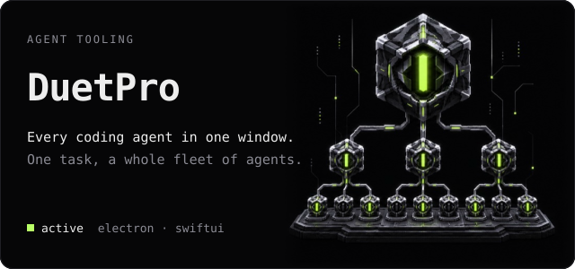

<p align="center"></p>

I build the production systems others don't want to touch: zero-knowledge privacy, self-custody, trading infrastructure, and the agent tooling I ship all of it with.

### Selected Work

<p>
<a href="https://github.com/eldardzh/nullmask"></a>
<a href="https://github.com/eldardzh/vaultos"></a>
<a href="https://github.com/eldardzh/duetpro"></a>
<a href="https://github.com/eldardzh/market-making-infra"></a>
<a href="https://github.com/eldardzh/weway-launchpad"></a>
<a href="https://github.com/eldardzh/prop-trading-platform"></a>
<a href="https://github.com/eldardzh/hiphop-defi"></a>
<a href="https://github.com/eldardzh/sundog"></a>
<a href="https://github.com/eldardzh/multichain-contracts"></a>
<a href="https://github.com/eldardzh/ai-engineering-agent"></a>
<a href="https://github.com/eldardzh/ton-launchpad"></a>
<a href="https://github.com/eldardzh/cex-admin-system"></a>
</p>

### Activity

<p align="center"></p>

<details>
<summary>Commits by month</summary>

| Month | Commits |
|---|---:|
| Nov 2026 | 1,863 |
| Oct 2026 | 2,108 |
| Sep 2026 | 1,024 |
| Aug 2026 | 333 |
| Jul 2026 | 60 |
| Jun 2026 | 72 |
| May 2026 | 244 |
| Apr 2026 | 58 |
| Mar 2026 | 61 |
| Feb 2026 | 36 |
| Jan 2026 | 44 |
| Dec 2025 | 13 |
| Nov 2025 | 11 |

</details>

<sub>Most of this work is in private repositories. <a href="https://github.com/eldardzh/activity-mirror">activity-mirror</a> carries the same dates onto the contribution graph, as empty commits with no code.</sub>

### More Work

- **[Multichain Wallet Stack](https://github.com/eldardzh/multichain-wallet-stack)** — self-custodial wallet across chains
- **[Sui On-Chain Toolkit](https://github.com/eldardzh/sui-onchain-toolkit)** — Move modules and on-chain trackers
- **[DEX Aggregator API](https://github.com/eldardzh/dex-aggregator-api)** — cross-DEX quote aggregation
- **[Solana Pump.fun Backend](https://github.com/eldardzh/solana-pumpfun-backend)** — high-throughput Solana backend patterns
- **[Telegram Bots Suite](https://github.com/eldardzh/telegram-bots-suite)** — production Telegram bots
- **[Trading Systems Toolkit](https://github.com/eldardzh/trading-systems-toolkit)** — strategy and execution simulator
- **[Grafana Observability Stack](https://github.com/eldardzh/grafana-observability-stack)** — Grafana, Prometheus and Loki
- **[Hetzner Terraform Modules](https://github.com/eldardzh/hetzner-terraform-modules)** — reusable Hetzner Cloud modules
- **[OKX Webflow Widget](https://github.com/eldardzh/okx-webflow-widget)** — embeddable OKX swap widget
- **[Web3 Landings](https://github.com/eldardzh/web3-landings-collection)** — marketing sites collection

[Browse all repositories](https://github.com/eldardzh?tab=repositories)

### Stack

<p align="center"></p>

### How I Work

```text
01  Architecture first.       Design carries the system, not code.
02  Ship the vertical slice.  End-to-end > 80% horizontal layers.
03  Production from day one.  Observability is not optional.
04  Invariants are sacred.    Idempotency, audit, replayability.
05  Reversibility > speed.    Anything I deploy, I can also roll back.
```

<p align="center">
  <sub>Available for select engagements</sub><br>
  <a href="https://x.com/EldarDissmay">@EldarDissmay</a> · dissmay21@gmail.com
</p>
