
<picture><source media="(max-width: 600px)" srcset="assets/profile-intro-mobile.gif">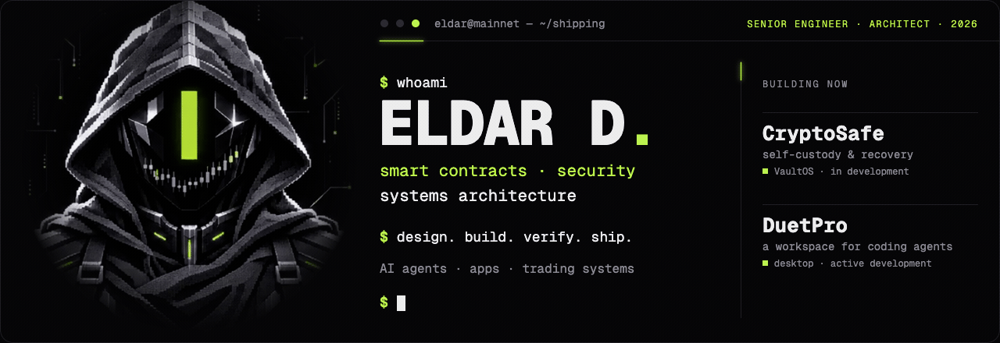</picture>

**I'm Eldar — a senior engineer and architect working across smart contracts, security, and production systems.** I turn complex systems into products people can use: from protocol logic and signing flows to desktop apps, AI tools, and the infrastructure behind them.

### Building Now

<a href="https://github.com/eldardzh/vaultos"><picture><source media="(max-width: 600px)" srcset="assets/product-cryptosafe-mobile.svg"></picture></a>

**CryptoSafe / VaultOS** — self-custody for people who want control over signing, co-owners, and recovery. [Explore the architecture →](https://github.com/eldardzh/vaultos)

<a href="https://github.com/eldardzh/duetpro"><picture><source media="(max-width: 600px)" srcset="assets/product-duetpro-mobile.svg"></picture></a>

**DuetPro** — my desktop workspace for coding agents: delegate tasks, coordinate parallel work, review the result. [Explore the product →](https://github.com/eldardzh/duetpro)

### Engineering Focus

- **Smart contracts** — Solidity, Anchor, Move, and Tact across EVM, Solana, Sui, and TON. Token sales, vesting, claims, AMMs, wallets, and protocol integrations.
- **Security** — authorization and signing boundaries, contract verification, RPC cross-checks, recovery paths, and explicit handling of uncertain transaction outcomes.
- **Architecture** — clear ownership of state, resilient services, agent orchestration, observability, and systems that remain understandable when something fails.

My wider work includes desktop and web products, developer tools, business automation, document processing, trading infrastructure, and on-chain systems. The projects below are a selection from that work.

### Selected Work

<a href="https://github.com/eldardzh/multichain-contracts">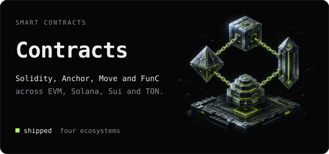</a>
<a href="https://github.com/eldardzh/market-making-infra"></a>
<a href="https://github.com/eldardzh/weway-launchpad"></a>
<a href="https://github.com/eldardzh/nullmask">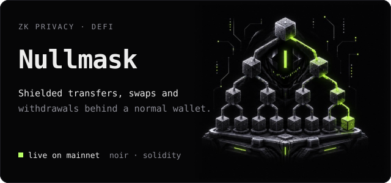</a>
<a href="https://github.com/eldardzh/prop-trading-platform">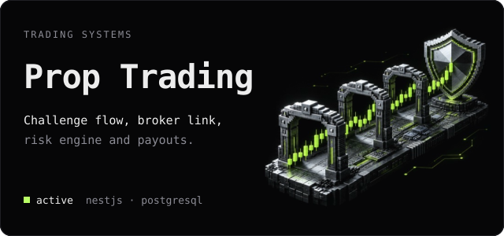</a>
<a href="https://github.com/eldardzh/hiphop-defi"></a>
<a href="https://github.com/eldardzh/sundog"></a>
<a href="https://github.com/eldardzh/ai-engineering-agent">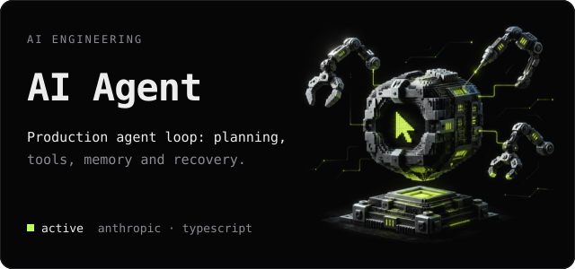</a>
<a href="https://github.com/eldardzh/ton-launchpad"></a>
<a href="https://github.com/eldardzh/cex-admin-system">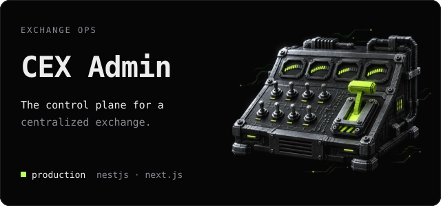</a>

### Activity

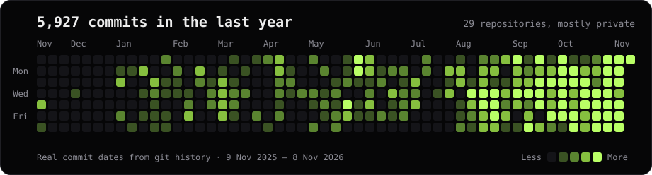

Commits by month

| Month | Commits |
|---|---:|
| Nov 2026 | 1,863 |
| Oct 2026 | 2,108 |
| Sep 2026 | 1,024 |
| Aug 2026 | 333 |
| Jul 2026 | 60 |
| Jun 2026 | 72 |
| May 2026 | 244 |
| Apr 2026 | 58 |
| Mar 2026 | 61 |
| Feb 2026 | 36 |
| Jan 2026 | 44 |
| Dec 2025 | 13 |
| Nov 2025 | 11 |

Most of this work is in private repositories. <a href="https://github.com/eldardzh/activity-mirror">activity-mirror</a> carries the same dates onto the contribution graph, as empty commits with no code.

### More Work

- **[Smart-contract portfolio](https://github.com/eldardzh/multichain-contracts)** — SURGE, sale and claim contracts, vesting, AMMs, and chain-specific integrations
- **[Multichain Wallet Stack](https://github.com/eldardzh/multichain-wallet-stack)** — self-custodial wallet across chains
- **[Sui On-Chain Toolkit](https://github.com/eldardzh/sui-onchain-toolkit)** — Move modules and on-chain trackers
- **[DEX Aggregator API](https://github.com/eldardzh/dex-aggregator-api)** — cross-DEX quote aggregation
- **[Solana Pump.fun Backend](https://github.com/eldardzh/solana-pumpfun-backend)** — high-throughput Solana backend patterns
- **[Telegram Bots Suite](https://github.com/eldardzh/telegram-bots-suite)** — production Telegram bots
- **[Trading Systems Toolkit](https://github.com/eldardzh/trading-systems-toolkit)** — strategy and execution simulator
- **[Grafana Observability Stack](https://github.com/eldardzh/grafana-observability-stack)** — Grafana, Prometheus and Loki
- **[Hetzner Terraform Modules](https://github.com/eldardzh/hetzner-terraform-modules)** — reusable Hetzner Cloud modules
- **[OKX Webflow Widget](https://github.com/eldardzh/okx-webflow-widget)** — embeddable OKX swap widget
- **[Web3 Landings](https://github.com/eldardzh/web3-landings-collection)** — marketing sites collection

[Browse all repositories](https://github.com/eldardzh?tab=repositories)

### Stack

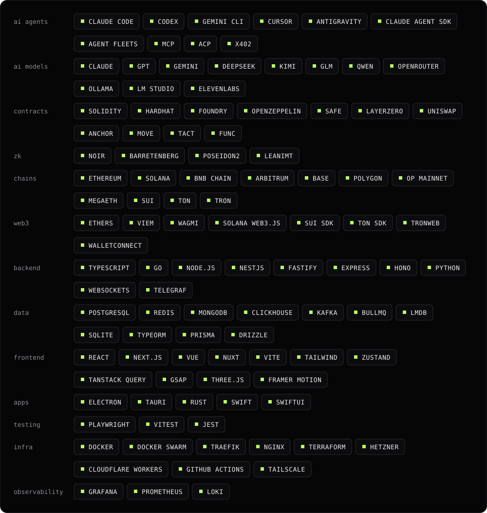

### How I Work

I use AI agents to explore, implement, and review. I check their work against the actual behavior: tests, running apps, transaction state, logs. A green answer in a chat is not a production check.

The interesting parts are usually at the boundaries: a wallet that lost its RPC, an agent that needs to recover, a document a scanner cannot read, a payment whose outcome is still unknown. That is where I spend my time.

Build notes, engineering decisions, experiments with agents, and programming life: [X / @EldarDissmay](https://x.com/EldarDissmay).

  Available for select engagements 
  <a href="https://x.com/EldarDissmay">@EldarDissmay</a> · dissmay21@gmail.com

